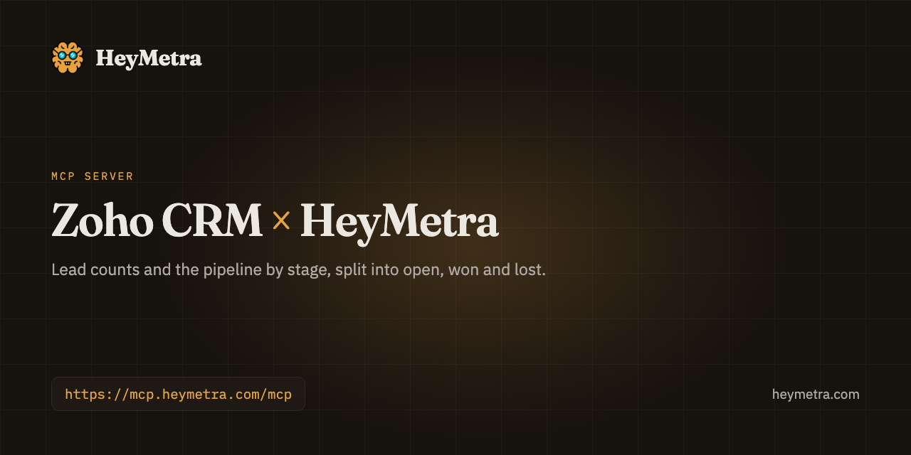

<div align="center">



# Zoho CRM &times; HeyMetra

**Lead counts and the pipeline by stage, split into open, won and lost.**

Your pipeline lives in Zoho CRM. What it cost to fill it lives somewhere else entirely. Ask once, across both.

[](https://registry.modelcontextprotocol.io/v0/servers/com.heymetra%2Fheymetra/versions)
[](https://modelcontextprotocol.io/)
[](https://heymetra.com/security/)
[](https://heymetra.com/connectors/zoho-crm/)

```
https://mcp.heymetra.com/mcp
```

</div>

---

## Ask it things like

> How many leads came in this week, and where did they come from?

> Which owner took the most leads last month?

> In the leads that came in this week, which service did people ask about?

> What is the open pipeline worth, and how much have we already won?

> How many open deals carry no amount at all?

> Which fields do our leads carry that we could group a report by?

> What subjects came up most in our call notes this month?

No dashboard, no export, no query language. You ask in the assistant you already use and the answer comes back with the account it came from.

## Connect Zoho CRM

**1. Decide which Zoho user will authorise it**

HeyMetra sees exactly what that user sees. A CRM with territories or role-based sharing shows different records to different people, so the account you sign in with decides the answers, not the plan or the permission switches.

> An administrator sees everything, which is usually what a question about the whole pipeline wants, and may be more than you intend to expose. Pick deliberately.

**2. Choose Zoho CRM on the Connections screen**

It sends you to Zoho's own sign-in page. Your password is typed on Zoho's screen and never reaches HeyMetra.

**3. Grant the three read permissions Zoho lists**

Modules, organisation and settings, all READ. Modules is the records themselves; settings is what lets HeyMetra read your own field names, so a custom field your team added comes back under the label they gave it.

> If you chose read only, nothing on this screen can write. If you chose to allow changes, Zoho also lists CREATE and UPDATE on modules, and never DELETE. A WRITE or ALL scope means you are on a different consent screen than the one HeyMetra asked for.

**4. Check the data centre matches**

Zoho runs separate data centres (.com, .eu, .in, .com.au and others), and an organisation lives in exactly one. HeyMetra picks up the right one from your sign-in.

> This is why signing in with the wrong regional account produces an empty CRM rather than an error: the credential is valid, it is simply pointed at a data centre your records are not in.

**5. Add HeyMetra to the assistant you use**

Claude, ChatGPT, Grok, Perplexity, Claude Code, Codex, Cursor or Antigravity. Your CRM answers there from the live data, and nothing is copied out of it.

The same steps are on the docs page: [Zoho CRM setup guide](https://heymetra.com/docs/zoho-crm/).

## Then add HeyMetra to your assistant

Add HeyMetra once and it is there in every conversation. The address is the same everywhere:

```
https://mcp.heymetra.com/mcp
```

### One command

```bash
npx add-mcp https://mcp.heymetra.com/mcp
```

[`add-mcp`](https://www.npmjs.com/package/add-mcp) is a third-party installer that writes the configuration for Claude Code, Codex, Cursor, Antigravity, VS Code and seventeen other agents. It infers the name from the address, so the server lands as `heymetra`. Run against this endpoint before it was written here.

### Or by hand

<details>
<summary><b>Claude</b> — Settings → Customize → Connectors → Add custom connector</summary>

Paste the address above into Settings → Customize → Connectors → Add custom connector.

_On Team and Enterprise plans, an owner adds the connector for the whole organization under Organization settings → Connectors, and each member then connects to it._

Full walkthrough: [heymetra.com/mcp/claude/](https://heymetra.com/mcp/claude/)
</details>

<details>
<summary><b>ChatGPT</b> — chatgpt.com/plugins → + → Add custom MCP server</summary>

Paste the address above into chatgpt.com/plugins → + → Add custom MCP server.

_Add it on chatgpt.com in a browser, because the mobile app cannot add one. Every ChatGPT plan can, Free included. In a Business, Enterprise or Edu workspace, an admin or owner decides whether members can add custom MCP servers. ChatGPT needs the full address, including /mcp at the end._

Full walkthrough: [heymetra.com/mcp/chatgpt/](https://heymetra.com/mcp/chatgpt/)
</details>

<details>
<summary><b>Grok</b> — grok.com/connectors → New Connector → Custom</summary>

Paste the address above into grok.com/connectors → New Connector → Custom.

_On Grok Business and Enterprise, a team admin has to provision the connector in xAI's cloud console before members can use it._

Full walkthrough: [heymetra.com/mcp/grok/](https://heymetra.com/mcp/grok/)
</details>

<details>
<summary><b>Perplexity</b> — Plugins → Add custom → Connector → Add MCP connector → Remote</summary>

Paste the address above into Plugins → Add custom → Connector → Add MCP connector → Remote.

_In an organization, members can add a custom connector only after an admin turns on Allow members to add custom connectors, which is off by default._

Full walkthrough: [heymetra.com/mcp/perplexity/](https://heymetra.com/mcp/perplexity/)
</details>

<details>
<summary><b>Claude Code</b> — claude mcp add --transport http</summary>

```bash
claude mcp add --transport http heymetra https://mcp.heymetra.com/mcp
```

_You can also add the server to a .mcp.json file at the project root. Run /mcp in a session to sign in and to check that it connected._

Full walkthrough: [heymetra.com/mcp/claude-code/](https://heymetra.com/mcp/claude-code/)
</details>

<details>
<summary><b>Codex</b> — ~/.codex/config.toml</summary>

```toml
[mcp_servers.heymetra]
url = "https://mcp.heymetra.com/mcp"
```

_Codex reads the server from an [mcp_servers.<name>] section in config.toml, and you sign in with codex mcp login <name>._

Full walkthrough: [heymetra.com/mcp/codex/](https://heymetra.com/mcp/codex/)
</details>

<details>
<summary><b>Cursor</b> — ~/.cursor/mcp.json, or .cursor/mcp.json in a project</summary>

```json
{
  "mcpServers": {
    "heymetra": { "url": "https://mcp.heymetra.com/mcp" }
  }
}
```

_Cursor signs in to HeyMetra without a client ID or secret, so the server entry needs no auth block._

Full walkthrough: [heymetra.com/mcp/cursor/](https://heymetra.com/mcp/cursor/)
</details>

<details>
<summary><b>Antigravity</b> — ~/.gemini/config/mcp_config.json, or .agents/mcp_config.json in a project</summary>

```json
{
  "mcpServers": {
    "heymetra": { "serverUrl": "https://mcp.heymetra.com/mcp" }
  }
}
```

_Antigravity's documented key for the address is serverUrl, though it also accepts url._

Full walkthrough: [heymetra.com/mcp/antigravity/](https://heymetra.com/mcp/antigravity/)
</details>

## What it may and may not touch

Propose a change to this account. Nothing is sent until you approve it, and HeyMetra cannot undo it afterwards.

Permissions are switched on per connection, and one you leave off is a tool your assistant never sees.

| Permission | What it covers | Changes anything? |
|---|---|---|
| **Included with the connection** | What HeyMetra needs to set the connection up, and nothing more. It cannot be switched off on its own; to withdraw it, remove the connection. | No, read only |
| **Full account access** | Lets your assistant read anything in this account to answer your questions. The figures are the provider's own, not ones HeyMetra has checked. It can also propose changes: none is applied until you approve it, and HeyMetra cannot undo one afterwards. | Yes — every change waits for your approval |

<details>
<summary>What each permission lets an assistant do, in full</summary>

- Ask anything about this account and get the answer from its live data. Reads only, and the figures are the provider's own rather than ones HeyMetra has checked.
- Propose a change to this account. Nothing is sent until you approve it, and HeyMetra cannot undo it afterwards.
</details>

Anything that would change something comes back as a proposal you approve, inside bounds that live in code rather than in a prompt: ±50% on a budget, 5 campaigns per action and 20 changes a rolling day, and an approval that expires after 30 minutes. [How that works](https://heymetra.com/security/).

## When something goes wrong

<details>
<summary>It connects, and the CRM looks empty or much smaller than it is.</summary>

**Why:** The Zoho user who authorised it cannot see those records. It may be a sharing rule, a territory, or simply a different organisation on a different data centre.

**Fix:** Disconnect and connect again as a user who can see them. Comparing one count against Zoho's own list view, signed in as that same user, tells you which of the two it is.

</details>

<details>
<summary>A field the team uses every day is missing from the answers.</summary>

**Why:** Custom fields are read from the module's own definitions, which needs the settings permission. Without it the standard fields still arrive and the custom ones silently do not.

**Fix:** Reconnect and grant all three permissions. Asking your assistant which fields it can see is the quickest way to tell whether a field is missing or merely empty.

</details>

<details>
<summary>Answers stop after a while and ask for a reconnect.</summary>

**Why:** The grant was revoked in Zoho, or the authorising user was deactivated. A connection is that person's access, so it ends when their access does.

**Fix:** Reconnect. If the person has left, connect as somebody who has not. That is why the first step asks you to choose deliberately.

</details>

## What HeyMetra reads from Zoho CRM

Connect the CRM once and ask about it from your assistant: lead counts for a period grouped by source, status, owner, day, or any field your Leads module carries, custom ones included; every deal by stage, split into open (the forecast), won (revenue already realised) and lost, each with the value of the deals that state an Amount; the fields your modules carry, so a report can be built on the fields your organisation actually uses; and, if you switch that permission on, what your call notes are about and who has been writing them, with the text of each note behind a second switch of its own. Deals with no Amount are counted, not valued, and the answer says how many. A pipeline is not worth less because somebody left a field empty. When you connect, you choose whether your assistant may only read, or also propose changes that wait for your approval.

<details>
<summary>About Zoho CRM</summary>

Zoho CRM manages your leads, contacts, and deals across the sales cycle. It’s the system of record for your pipeline and sales activity.
</details>

## One connection, not seven

The reason to read Zoho CRM through HeyMetra rather than through a server that only knows Zoho CRM is everything else it can answer in the same breath:

**Ads** — [Google Ads](https://github.com/zeisoft/google-ads-mcp)

**Analytics** — [Google Analytics 4](https://github.com/zeisoft/google-analytics-4-mcp) · [Google Search Console](https://github.com/zeisoft/google-search-console-mcp) · [PostHog](https://github.com/zeisoft/posthog-mcp)

**Ecommerce** — [Trendyol](https://github.com/zeisoft/trendyol-mcp) · [n11](https://github.com/zeisoft/n11-mcp) · [Çiçeksepeti](https://github.com/zeisoft/ciceksepeti-mcp) · [Amazon Seller Central](https://github.com/zeisoft/amazon-seller-central-mcp) · [ikas](https://github.com/zeisoft/ikas-mcp) · [WooCommerce](https://github.com/zeisoft/woocommerce-mcp)

**Revenue & CRM** — [Stripe](https://github.com/zeisoft/stripe-mcp) · **Zoho CRM** · [Zoho SalesIQ](https://github.com/zeisoft/zoho-salesiq-mcp) · [Zoho Marketing Automation](https://github.com/zeisoft/zoho-marketing-automation-mcp)

**Mobile** — [AppsFlyer](https://github.com/zeisoft/appsflyer-mcp) · [RevenueCat](https://github.com/zeisoft/revenuecat-mcp) · [Adapty](https://github.com/zeisoft/adapty-mcp) · [App Store Connect](https://github.com/zeisoft/app-store-connect-mcp)

**Work** — [Jira](https://github.com/zeisoft/jira-mcp)

**Channels** — [Slack](https://github.com/zeisoft/slack-mcp) · [Telegram](https://github.com/zeisoft/telegram-mcp)

The full catalogue is at [heymetra.com/connectors/](https://heymetra.com/connectors/).

## Links

- [Zoho CRM connector page](https://heymetra.com/connectors/zoho-crm/)
- [Zoho CRM setup guide](https://heymetra.com/docs/zoho-crm/)
- [HeyMetra](https://heymetra.com/) — what the product is
- [Setup for every assistant](https://heymetra.com/mcp/)
- [Security and limits](https://heymetra.com/security/)
- [Pricing](https://heymetra.com/pricing/)
- [HeyMetra's own repository](https://github.com/zeisoft/heymetra-mcp)

---

<sub>Built by <a href="https://zeisoft.com">Zeisoft</a>, who make HeyMetra. Not affiliated with Zoho CRM. This README is generated from HeyMetra's live connector catalogue and refreshed daily; corrections are welcome as issues.</sub>
